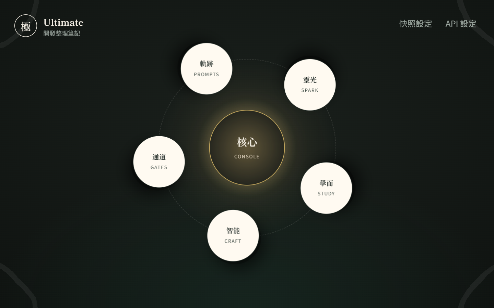
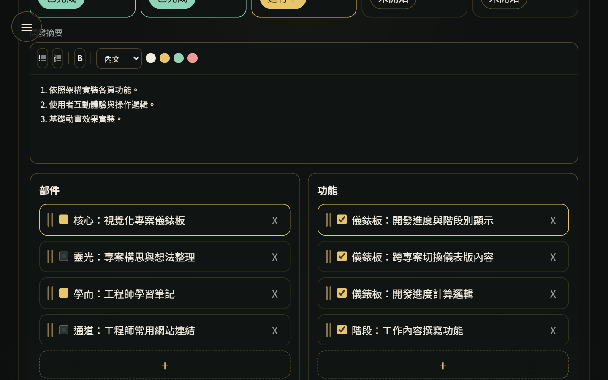
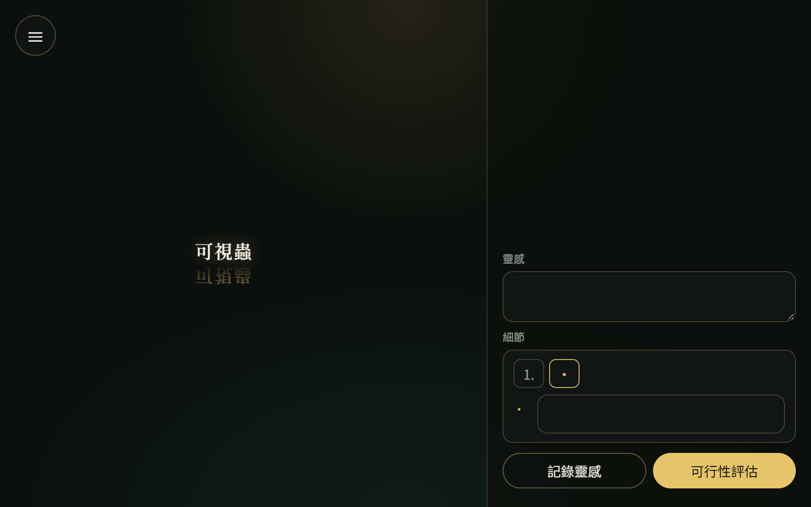
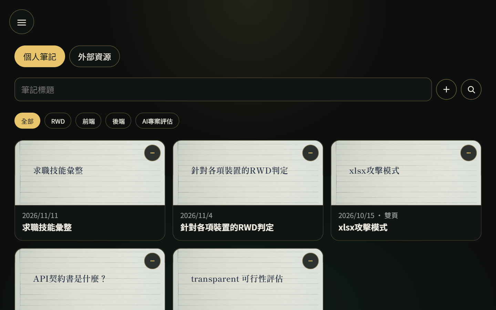
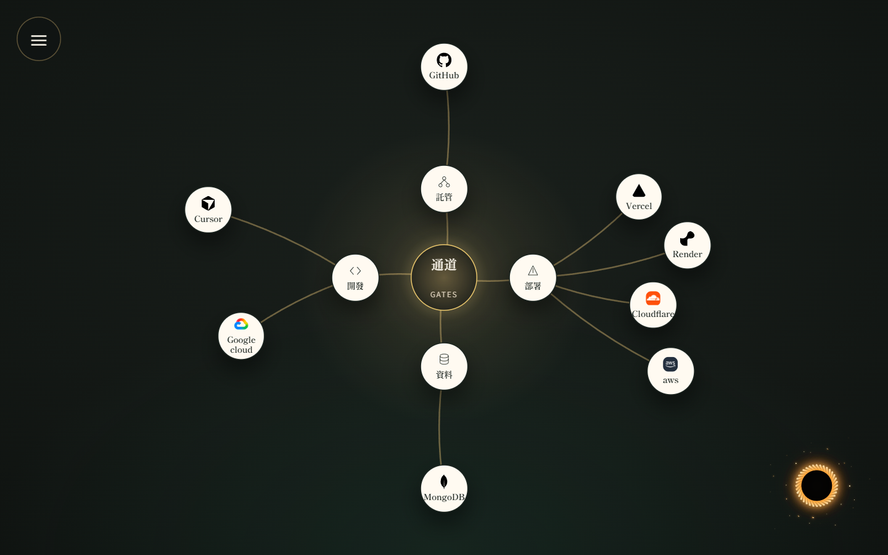
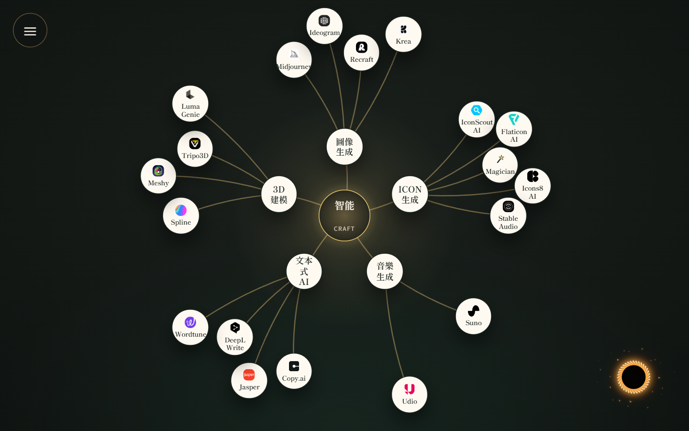
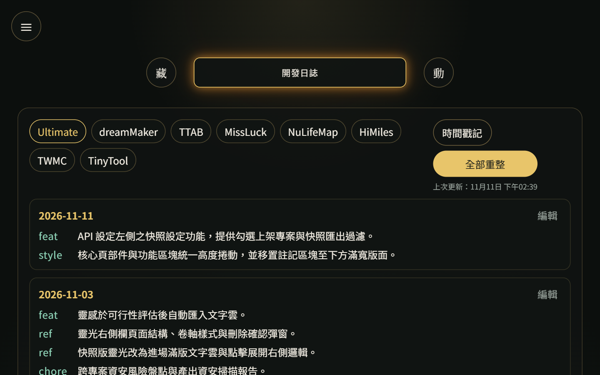

# Ultimate — 開發整理筆記

前端工程師用的本機開發整理介面：把專案規劃、靈感評估、學習筆記、常用連結、AI 工具入口與開發日誌放在同一個星系式工作台。本機可完整編輯；匯出快照後可上架成唯讀展示站。

**Demo（展示快照）：** [https://ultimate-iota-bay.vercel.app](https://ultimate-iota-bay.vercel.app)

---

## 解決了什麼痛點

在著手進行 TTAB 的開發時，因為缺乏一個好的筆記軟體，可以及時去彙整我的開發過程，因此萌生了開發一個開發者介面的想法，也可以當作是成果展示，Ultimate 就誕生了。

我清楚知道每間公司有一套既定的使用流程，所以此專案並不是面向多位使用者，而是我自己專屬的、用的順手的即可，因此在開發過程中可以更加肆無忌憚去嘗試，我以宇宙霓虹為意象，加入了很炫麗的動畫與互動動態效果，有星環模式、星鍊模式、傳送門，屬於開發的很開心的專案。

---

## 技術棧（Tech Stack）

| 層級 | 技術 |
| --- | --- |
| 前端 | React 19、TypeScript、Vite 6 |
| 後端 | Express 5（`tsx` 本機開發）、Multer（上傳） |
| 資料 | SQLite（`node:sqlite`，`data/ultimate.db`）＋ JSON sidecar |
| AI | Gemini／OpenAI 相容 API（可行性評估、學習摘要、開發日誌整理、Agent prompt） |
| 本機整合 | 掃描 `Desktop/Project` 與 Cursor `agent-transcripts`、讀取 Git log |
| 部署 | 本機開發伺服器；展示站以快照 JSON 建置後部署至 Vercel |

---

## 核心功能與技術亮點

### 星系式模組入口

首頁以核心為中心，靈光／學而／通道／智能／軌跡繞行；另有快照設定與 API 設定入口。

### 核心：跨專案進度儀表板

五階段狀態、部件／功能勾選與進度計算、富文字開發摘要與註記、託管網址一覽；可產出可行性評估／架構用 Agent prompt。

### 靈光：靈感與可行性評估

左側文字雲（含倒影），右側寫靈感與細節；可記錄靈感，或直接做可行性評估並回流文字雲。

### 學而：工程師學習筆記

個人筆記／外部資源雙頁，標籤篩選與紙感卡片；支援 Markdown 與 AI 摘要整理。

### 通道：開發入口星鏈

以星鏈展開託管、部署、資料、開發等常用站點，可拖曳整理並送入傳送門。

### 智能：AI 工具星鏈

依圖像／3D／ICON／文本／音樂等分類收納常用 AI 服務入口。

### 軌跡：開發日誌

從本機 Cursor 對話與 Git 提交整理日誌，依日期與綴詞（feat／fix／docs…）輸出；另有 prompt 收藏與動畫／布局實驗。

### 本機可編／託管唯讀

偵測本機 API 為 edit mode；否則讀取 `snapshot.json` 進入展示模式，寫入 API 全部拒絕。匯出快照可勾選上架專案，並自動 build 部署至 Vercel。
